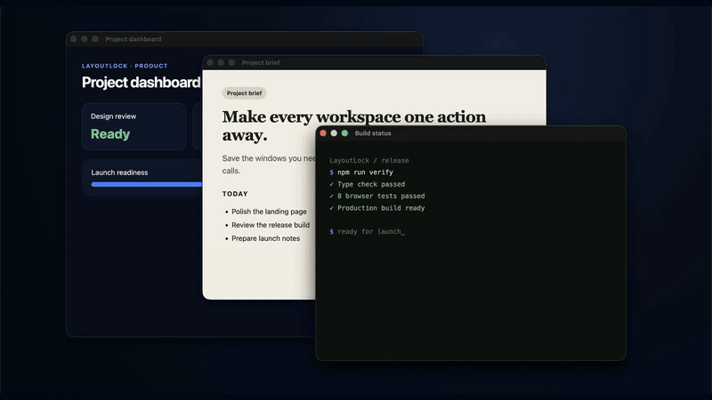

# LayoutLock

**[Download for Mac](https://layoutlock.app/download)** · [Website](https://layoutlock.app)

LayoutLock is a macOS menu bar app that saves your window layout and restores
the full arrangement later, relaunching apps, reopening tabs and documents, and
repositioning windows across your displays.

[](https://layoutlock.app/media/demo-loop.mp4)

## Features

- **Save and restore layouts** from the menu bar or the dashboard window.
- **Display-relative positioning** — frames are stored as ratios per display, so
  layouts survive resolution and DPI changes and re-flow onto the right screen.
- **Relaunches inactive apps** automatically when a layout is restored.
- **Per-layout global hotkeys** to restore a layout from anywhere.
- **Pin layouts** to keep them at the top of the dashboard and menu bar lists.
- **Browser tab capture** for Safari and Chrome (tabs are saved and reopened
  alongside the rest of the layout).
- **Opening targets** — reopen the documents, folders, and URLs a window had
  open.
- **Dashboard preview** with a mini visual representation of each saved layout.
- **Manage layouts** — rename, update, delete, remove individual windows, and
  (with Pro) customize restore order.
- **Display-change suggestions** (Pro) — when your display setup changes,
  LayoutLock offers matching layouts to restore.
- **Quality-of-life** — launch at login, System/Light/Dark appearance, optional
  Dock icon.
- **Native auto-updates** via Sparkle with a custom update window.
- **Local-only diagnostics** — no remote analytics.

## Requirements

- macOS 14.0 (Sonoma) or newer.
- **Accessibility** permission (required to inspect and move windows).
- **Automation (Apple Events)** permission (only required to save and restore
  Safari/Chrome browser tabs).

## Development

Building LayoutLock requires Xcode 26 or newer. Run the macOS test suite with:

```sh
xcodebuild test -project LayoutLock.xcodeproj -scheme LayoutLock -destination 'platform=macOS'
```

Run the repository lint check after making changes:

```sh
Scripts/lint.sh
```

## Download

Download the official, notarized DMG from
[layoutlock.app/download](https://layoutlock.app/download).

## Permissions

LayoutLock uses two distinct macOS permissions, requested independently:

- **Accessibility** — needed to read window state and move/resize windows. Until
  it is granted, the app runs in a limited mode and prompts from the menu bar
  and onboarding window.
- **Automation (Apple Events)** — needed only when you connect Safari or Chrome
  so LayoutLock can save and restore browser tabs.

## Free vs Pro

LayoutLock is free to use for saving and restoring window layouts. LayoutLock
Pro adds power-user features with a one-time purchase (no subscription).

| Feature                                      | Free            | Pro               |
| -------------------------------------------- | --------------- | ----------------- |
| Save and restore window layouts              | Up to 3 layouts | Unlimited layouts |
| Restore layouts from the dashboard           | Yes             | Yes               |
| Restore layouts from the menu bar            | Yes             | Yes               |
| Relaunch inactive apps during restore        | Yes             | Yes               |
| Display-relative window positioning          | Yes             | Yes               |
| Dashboard layout preview                     | Yes             | Yes               |
| Rename, update, and delete layouts           | Yes             | Yes               |
| Launch at login                              | Yes             | Yes               |
| Local diagnostic logs                        | Yes             | Yes               |
| Per-layout global hotkeys                    | Yes             | Yes               |
| Pin layouts for quick access                 | Yes             | Yes               |
| Remove individual windows from saved layouts | Yes             | Yes               |
| Restore suggestions when displays change     | —               | Yes               |
| Customize window restore order               | —               | Yes               |

LayoutLock Pro is a one-time purchase (no subscription). The app is open source;
purchasing Pro supports continued development and provides the easiest way to
use the official Pro build. See
[layoutlock.app/#pricing](https://layoutlock.app/#pricing) for current pricing.

## Data And Privacy

- **Snapshots** are stored locally as JSON under the app's Application Support
  directory.
- **Diagnostic logs** are local records used to troubleshoot capture and restore
  issues. They are never uploaded automatically, window titles are filtered out,
  entries older than 7 days are removed, and the file is capped at 5 MiB. Use the
  Diagnostics Settings tab to export, reveal, or delete the log. Contact Support
  attaches the local log when one is available.
- **License data** — the entitlement receipt and a per-device credential are kept
  in the macOS Keychain.

LayoutLock contains no remote analytics or usage tracking.

## Updates

When automatic checking is enabled, LayoutLock checks for updates on launch and
periodically while it is running. Downloading and installing an update always
requires your confirmation. Automatic checks can be turned off in General
Settings.

## Support

- Website: [layoutlock.app](https://layoutlock.app)
- Email: [support@layoutlock.app](mailto:support@layoutlock.app)

## License

LayoutLock is released under the [MIT License](LICENSE).
